# diagram-skill

Excalidraw architecture diagrams in Hohpe & Woolf Enterprise Integration Patterns notation, generated from a small JSON spec by a stdlib-only Python script: a preview SVG, strict layout checks, and a real Excalidraw PNG export. It is packaged as the Agent Skill `excalidraw-architecture`, so a coding agent can draw, check and fix a diagram on its own.

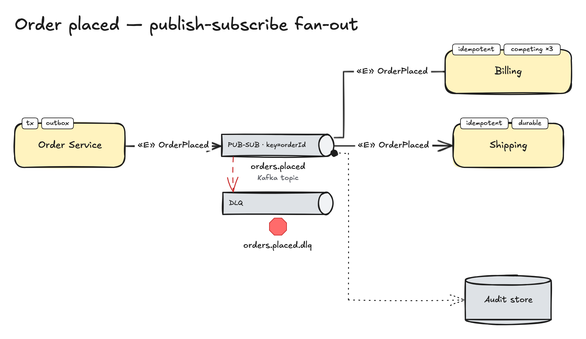

That diagram is built from the 6-node spec [`docs/fan-out.spec.json`](docs/fan-out.spec.json). The larger example, [order flow](skills/excalidraw-architecture/examples/order-flow.svg) (17 nodes: a saga with request-reply, a content-based router, two frames, a legend), is wider than this page, so open it to read it. A real-world set drawn with it: the [ankusa diagrams](https://github.com/jamescarr/ankusa/tree/main/docs/diagrams).

## Install

### Any agent (npx skills)

```sh
# into the current project; prompts for which agents to install for
npx skills add jamescarr/diagram-skill

# globally, for one agent
npx skills add jamescarr/diagram-skill -g -a claude-code -y
```

`-a` also takes `codex`, `cursor`, `opencode`, `gemini-cli`, `github-copilot`, … and installs into that agent's skills directory (`~/.claude/skills/`, `~/.agents/skills/`, `~/.cursor/skills/`, …).

### Claude Code plugin

```sh
claude plugin marketplace add jamescarr/diagram-skill
claude plugin install diagram-skill@jamescarr-skills
```

The skill is then `/diagram-skill:excalidraw-architecture`.

### omp

```sh
git clone https://github.com/jamescarr/diagram-skill ~/src/diagram-skill
ln -s ~/src/diagram-skill/skills/excalidraw-architecture ~/.omp/agent/skills/excalidraw-architecture
```

For one project only, `npx skills add jamescarr/diagram-skill` puts it in `.agents/skills/`, which omp loads.

### Manual

Clone as above, then symlink or `cp -r` `skills/excalidraw-architecture` into `~/.claude/skills/`, `~/.agents/skills/` (Codex and other `.agents`-based agents), or a project's `.claude/skills/` or `.agents/skills/`.

## Requirements

- Building a diagram: python3 >= 3.12, stdlib only.
- `--png`: node >= 22, Chrome or Chromium (`CHROME` overrides the lookup), and network access to esm.sh.

## Use

```sh
# the node kinds, endpoint badges, edge kinds and aliases the spec accepts
python3 skills/excalidraw-architecture/scripts/eip_excalidraw.py kinds

# write <name>.excalidraw and <name>.svg; --png adds an Excalidraw-rendered PNG
python3 skills/excalidraw-architecture/scripts/eip_excalidraw.py build <name>.spec.json --png

# validate and lay out without writing; warnings fail the run
python3 skills/excalidraw-architecture/scripts/eip_excalidraw.py build <name>.spec.json --check --strict
```

The agent workflow (inventory, level, spec, build, look, fix) is in [`SKILL.md`](skills/excalidraw-architecture/SKILL.md); the spec format is in [`references/spec.md`](skills/excalidraw-architecture/references/spec.md). Every shape a spec can ask for is in [Stencils](#stencils) below.

## Stencils

One stencil per node kind, badge and arrow: what the generator draws, and what you write in a spec to get it. The same set is an Excalidraw library, [`library/eip.excalidrawlib`](skills/excalidraw-architecture/library/eip.excalidrawlib), which you can load into excalidraw.com to draw by hand.

<!-- stencils:start -->
### Messaging systems — channels

| Stencil | Kind | Use when |
|---|---|---|
| 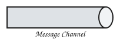 | **Message Channel**<br>`channel` | A message moves between participants and p2p vs pub-sub is not yet decided. |
|  | **Point-to-Point Channel**<br>`p2p-channel` or `queue` | Exactly one consumer handles each message. |
| 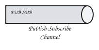 | **Publish-Subscribe Channel**<br>`pubsub-channel` or `topic` | Every subscriber receives every message. |
|  | **Datatype Channel**<br>`datatype-channel` | The channel carries one payload type. |
|  | **Dead Letter Channel**<br>`dead-letter-channel` or `dlq` | Messages that cannot be delivered or processed after bounded attempts. |
| 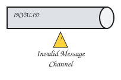 | **Invalid Message Channel**<br>`invalid-message-channel` | Messages that fail validation, kept separate so bad producers are visible. |
|  | **Message Bus**<br>`message-bus` | A shared bus, envelope and conventions across many applications; the context-level broker. |
|  | **Control Bus**<br>`control-bus` | Management commands and status on their own channel. |

### Message construction

| Stencil | Kind | Use when |
|---|---|---|
|  | **Message**<br>`message` | A message in flight where the type is not the point. |
|  | **Command Message**<br>`command-message` | One receiver, do this; imperative name. |
|  | **Document Message**<br>`document-message` | Here is data; noun name. |
|  | **Event Message**<br>`event-message` | This happened; past-tense name. |

### Routing

| Stencil | Kind | Use when |
|---|---|---|
|  | **Content-Based Router**<br>`content-based-router` or `message-router` | Route each message by payload or header rules. |
|  | **Message Filter**<br>`message-filter` | Drop messages a consumer does not want. |
|  | **Dynamic Router**<br>`dynamic-router` | Destinations are registered at runtime. |
|  | **Recipient List**<br>`recipient-list` | Send one message to a computed list of recipients. |
|  | **Splitter**<br>`splitter` | One message with many items becomes one message per item. |
| 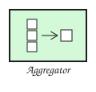 | **Aggregator**<br>`aggregator` | Reassemble parts, with an explicit completion rule (count, timeout, predicate). |
|  | **Resequencer**<br>`resequencer` | Restore order by sequence number with a gap timeout. |
|  | **Composed Message Processor**<br>`composed-message-processor` | Split, process the parts, aggregate the results. |
| 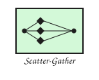 | **Scatter-Gather**<br>`scatter-gather` | Broadcast a request and gather replies with a timeout. |
|  | **Routing Slip**<br>`routing-slip` | Each message carries its own list of steps. |
|  | **Process Manager**<br>`process-manager` | The next step depends on intermediate results, state or timeouts. |
|  | **Saga (Process Manager)**<br>`saga` | A long-running flow with compensation (same glyph as Process Manager). |

### Transformation

| Stencil | Kind | Use when |
|---|---|---|
|  | **Message Translator**<br>`message-translator` | Format or model changes between hops, typically at a bounded-context border. |
| 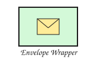 | **Envelope Wrapper**<br>`envelope-wrapper` | Transport metadata is added at the boundary and stripped at the other side. |
|  | **Content Enricher**<br>`content-enricher` | The message needs data fetched from elsewhere. |
|  | **Content Filter**<br>`content-filter` | Strip the payload to the fields the consumer needs. |
|  | **Claim Check**<br>`claim-check` | Store the payload and send a reference. |
|  | **Normalizer**<br>`normalizer` | Several input formats become one common format. |

### Messaging endpoints

| Stencil | Kind | Use when |
|---|---|---|
|  | **Message Endpoint**<br>`message-endpoint` | A generic receive point; the endpoint style is not the point. |
| 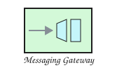 | **Messaging Gateway**<br>`messaging-gateway` | Expose a domain interface over messaging (`orders.place(order)`). |
| 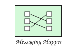 | **Messaging Mapper**<br>`messaging-mapper` | Map domain objects to and from messages. |
|  | **Transactional Client**<br>`transactional-client` | Send or receive is tied to the local transaction. |
|  | **Polling Consumer**<br>`polling-consumer` | The consumer pulls at its own pace (long polling, batches). |
| 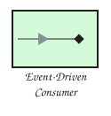 | **Event-Driven Consumer**<br>`event-driven-consumer` | The broker pushes; bounded prefetch. |
|  | **Competing Consumers**<br>`competing-consumers` | Several instances share one point-to-point channel. |
|  | **Message Dispatcher**<br>`message-dispatcher` | One consumer hands messages to specific performers. |
| 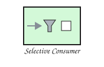 | **Selective Consumer**<br>`selective-consumer` | The broker filters by selector before delivery. |
|  | **Durable Subscriber**<br>`durable-subscriber` | No message gaps while the subscriber is down. |
| 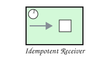 | **Idempotent Receiver**<br>`idempotent-receiver` | The handler is safe under redelivery. |
| 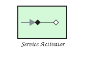 | **Service Activator**<br>`service-activator` | A thin adapter invokes a plain service method. |
|  | **Channel Adapter**<br>`channel-adapter` | Connect an application or protocol to the messaging system. |

### System management

| Stencil | Kind | Use when |
|---|---|---|
|  | **Wire Tap**<br>`wire-tap` | Copy messages to a side channel for audit or debugging. |
| 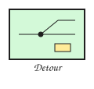 | **Detour**<br>`detour` | Route through extra steps switched on at runtime. |
|  | **Message History**<br>`message-history` | Record each hop on the message. |
| 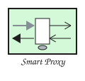 | **Smart Proxy**<br>`smart-proxy` | Intercept requests and replies to measure them, then forward. |
|  | **Test Message**<br>`test-message` | Inject a probe periodically and verify it at the end of the flow. |
| 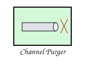 | **Channel Purger**<br>`channel-purger` | Clear leftover junk in test setup or recovery, scoped and logged. |

### Messaging infrastructure

| Stencil | Kind | Use when |
|---|---|---|
|  | **Message Broker**<br>`message-broker` | The broker is a participant; keep it to hub routing, no business logic. |
|  | **Messaging Bridge**<br>`messaging-bridge` | Connect two brokers or broker clusters. |
| 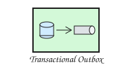 | **Transactional Outbox**<br>`outbox` | Publish as part of the local transaction. |
| 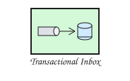 | **Transactional Inbox**<br>`inbox` | Dedupe/consume as part of the local transaction. |

### Participants and stores

| Stencil | Kind | Use when |
|---|---|---|
|  | **Application**<br>`service` | A service or application you own. |
| 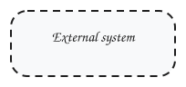 | **External system**<br>`external-system` or `external` | A system outside your control. |
| 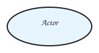 | **Actor**<br>`actor` | A person or client. |
|  | **Data store**<br>`datastore` or `db` | State the service owns. |
|  | **Message Store**<br>`message-store` | Copies of messages for audit, replay or reconciliation. |
| 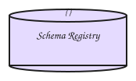 | **Schema Registry**<br>`schema-registry` | Where message schemas live. |
|  | **Note**<br>`note` | A sticky annotation; use `attach` to place it under a node. |

### Badges

Pills on a `service` or `external-system` node, e.g. `"badges": ["idempotent", "competing:3"]`.

| Stencil | Badge | Use when |
|---|---|---|
|  | **Messaging Gateway**<br>`gateway` | The service is reached through a messaging interface. |
|  | **Messaging Mapper**<br>`mapper` | The service maps domain objects to messages. |
|  | **Service Activator**<br>`activator` | The endpoint calls a plain service method. |
|  | **Transactional Client**<br>`tx` | Send/receive is tied to the service's transaction. |
| 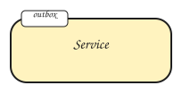 | **Transactional Outbox**<br>`outbox` | Publishes are written in the same transaction as the state change. |
| 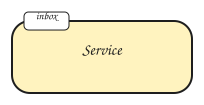 | **Transactional Inbox**<br>`inbox` | Consumes are deduplicated in the same transaction. |
|  | **Polling Consumer**<br>`polling` | The service pulls. |
|  | **Event-Driven Consumer**<br>`event-driven` | The broker pushes. |
| 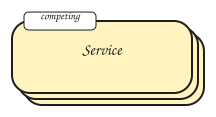 | **Competing Consumers**<br>`competing` | Several instances consume the same channel; `competing:N` states the count. |
|  | **Message Dispatcher**<br>`dispatcher` | One consumer hands work to specific performers. |
|  | **Selective Consumer**<br>`selective` | The service receives only selected messages. |
|  | **Durable Subscriber**<br>`durable` | The subscription survives downtime. |
| 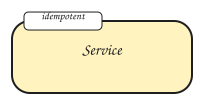 | **Idempotent Receiver**<br>`idempotent` | Redelivery is safe. |
|  | **Channel Adapter**<br>`adapter` | A protocol or legacy system is adapted to messaging. |
|  | **Bulkhead**<br>`bulkhead` | Failures are isolated per pool. |
|  | **Retry**<br>`retry` | Bounded retries before the DLQ. |
| 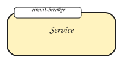 | **Circuit Breaker**<br>`circuit-breaker` | The caller stops calling a failing dependency. |

### Arrows

| Stencil | Edge | Means |
|---|---|---|
|  | **Message**<br>`"kind": "message"` (the default) | A message on a channel. |
|  | **Command Message**<br>`"type": "command"` | A command. |
|  | **Event Message**<br>`"type": "event"` | An event. |
| 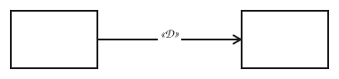 | **Document Message**<br>`"type": "document"` | A document. |
|  | **Reply (Request-Reply)**<br>`"type": "reply"` | A reply. |
| 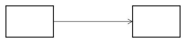 | **Synchronous call (RPC)**<br>`"kind": "rpc"` | A synchronous call — the exception. |
| 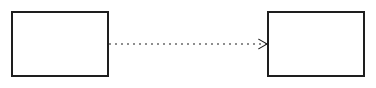 | **Data access**<br>`"kind": "data"` | A direct data access. |
| 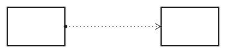 | **Wire Tap copy**<br>`"kind": "tap"` | A copy is taken without disturbing the flow. |
| 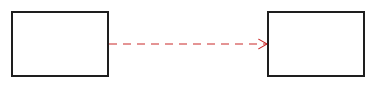 | **Dead letter route**<br>`"kind": "dlq"` | A failed message is routed to a dead letter channel. |
| 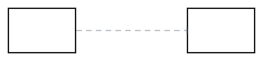 | **Control Bus command**<br>`"kind": "control"` | A management command. |
<!-- stencils:end -->

## Develop

```sh
uv sync
uv run pytest -q
uv run agentskills validate skills/excalidraw-architecture
claude plugin validate .

# rebuild the README diagram after changing its spec or the generator
python3 skills/excalidraw-architecture/scripts/eip_excalidraw.py build docs/fan-out.spec.json --no-svg --strict --png

# regenerate docs/stencils/ and the README's stencil tables after changing the generator or the
# kind, badge and edge tables in references/spec.md and references/notation.md
python3 tools/stencils.py
```

## License

MIT
