# diagram-skill

Excalidraw architecture diagrams in Hohpe & Woolf Enterprise Integration Patterns notation, generated from a small JSON spec by a dependency-free Node script: a preview SVG, strict layout checks, and a real Excalidraw PNG export. It is packaged as the Agent Skill `excalidraw-architecture`, so a coding agent can draw, check and fix a diagram on its own.


That diagram is built from the 6-node spec [`docs/fan-out.spec.json`](docs/fan-out.spec.json). The larger example, [order flow](skills/excalidraw-architecture/examples/order-flow.svg) (17 nodes: a saga with request-reply, a content-based router, two frames, a legend), is wider than this page, so open it to read it. A real-world set drawn with it: the [ankusa diagrams](https://github.com/jamescarr/ankusa/tree/main/docs/diagrams).

## Install

### Any agent (npx skills)

```sh
# into the current project; prompts for which agents to install for
npx skills add jamescarr/diagram-skill

# globally, for one agent
npx skills add jamescarr/diagram-skill -g -a claude-code -y
```

`-a` also takes `codex`, `cursor`, `opencode`, `gemini-cli`, `github-copilot`, … and installs into that agent's skills directory (`~/.claude/skills/`, `~/.agents/skills/`, `~/.cursor/skills/`, …).

### Claude Code plugin

```sh
claude plugin marketplace add jamescarr/diagram-skill
claude plugin install diagram-skill@jamescarr-skills
```

The skill is then `/diagram-skill:excalidraw-architecture`.

### omp

```sh
git clone https://github.com/jamescarr/diagram-skill ~/src/diagram-skill
ln -s ~/src/diagram-skill/skills/excalidraw-architecture ~/.omp/agent/skills/excalidraw-architecture
```

For one project only, `npx skills add jamescarr/diagram-skill` puts it in `.agents/skills/`, which omp loads.

### Manual

Clone as above, then symlink or `cp -r` `skills/excalidraw-architecture` into `~/.claude/skills/`, `~/.agents/skills/` (Codex and other `.agents`-based agents), or a project's `.claude/skills/` or `.agents/skills/`.

## Requirements

- Node >= 22. Nothing to install: the generator has no dependencies.
- `--png` also needs Chrome or Chromium (`CHROME` overrides the lookup) and network access to esm.sh.

## Use

```sh
# the node kinds, endpoint badges, edge kinds and aliases the spec accepts
node skills/excalidraw-architecture/scripts/eip_excalidraw.mjs kinds

# write <name>.excalidraw and <name>.svg; --png adds an Excalidraw-rendered PNG
node skills/excalidraw-architecture/scripts/eip_excalidraw.mjs build <name>.spec.json --png

# validate and lay out without writing; warnings fail the run
node skills/excalidraw-architecture/scripts/eip_excalidraw.mjs build <name>.spec.json --check --strict
```

The agent workflow (inventory, level, spec, build, look, fix) is in [`SKILL.md`](skills/excalidraw-architecture/SKILL.md); the spec format is in [`references/spec.md`](skills/excalidraw-architecture/references/spec.md). Every shape a spec can ask for is in [Stencils](#stencils) below.

## Stencils

One stencil per node kind, badge and arrow: what the generator draws, and what you write in a spec to get it. The same set is an Excalidraw library, [`library/eip.excalidrawlib`](skills/excalidraw-architecture/library/eip.excalidrawlib), which you can load into excalidraw.com to draw by hand.

<!-- stencils:start -->
### Messaging systems — channels

<table>
<tr><th width="232">Stencil</th><th width="228">Kind</th><th>Use when</th></tr>
<tr><td></td><td><b>Message Channel</b><br><code>channel</code></td><td>A message moves between participants and p2p vs pub-sub is not yet decided.</td></tr>
<tr><td>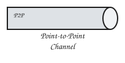</td><td><b>Point-to-Point Channel</b><br><code>p2p-channel</code> or <code>queue</code></td><td>Exactly one consumer handles each message.</td></tr>
<tr><td></td><td><b>Publish-Subscribe Channel</b><br><code>pubsub-channel</code> or <code>topic</code></td><td>Every subscriber receives every message.</td></tr>
<tr><td>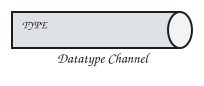</td><td><b>Datatype Channel</b><br><code>datatype-channel</code></td><td>The channel carries one payload type.</td></tr>
<tr><td>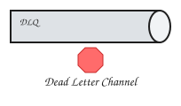</td><td><b>Dead Letter Channel</b><br><code>dead-letter-channel</code> or <code>dlq</code></td><td>Messages that cannot be delivered or processed after bounded attempts.</td></tr>
<tr><td></td><td><b>Invalid Message Channel</b><br><code>invalid-message-channel</code></td><td>Messages that fail validation, kept separate so bad producers are visible.</td></tr>
<tr><td>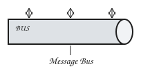</td><td><b>Message Bus</b><br><code>message-bus</code></td><td>A shared bus, envelope and conventions across many applications; the context-level broker.</td></tr>
<tr><td>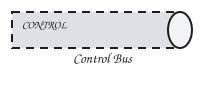</td><td><b>Control Bus</b><br><code>control-bus</code></td><td>Management commands and status on their own channel.</td></tr>
</table>

### Message construction

<table>
<tr><th width="187">Stencil</th><th width="171">Kind</th><th>Use when</th></tr>
<tr><td>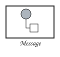</td><td><b>Message</b><br><code>message</code></td><td>A message in flight where the type is not the point.</td></tr>
<tr><td>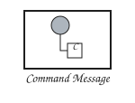</td><td><b>Command Message</b><br><code>command-message</code></td><td>One receiver, do this; imperative name.</td></tr>
<tr><td>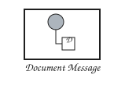</td><td><b>Document Message</b><br><code>document-message</code></td><td>Here is data; noun name.</td></tr>
<tr><td>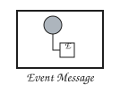</td><td><b>Event Message</b><br><code>event-message</code></td><td>This happened; past-tense name.</td></tr>
</table>

### Routing

<table>
<tr><th width="220">Stencil</th><th width="253">Kind</th><th>Use when</th></tr>
<tr><td>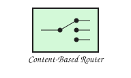</td><td><b>Content-Based Router</b><br><code>content-based-router</code> or <code>message-router</code></td><td>Route each message by payload or header rules.</td></tr>
<tr><td>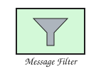</td><td><b>Message Filter</b><br><code>message-filter</code></td><td>Drop messages a consumer does not want.</td></tr>
<tr><td>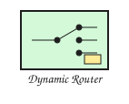</td><td><b>Dynamic Router</b><br><code>dynamic-router</code></td><td>Destinations are registered at runtime.</td></tr>
<tr><td>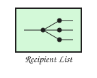</td><td><b>Recipient List</b><br><code>recipient-list</code></td><td>Send one message to a computed list of recipients.</td></tr>
<tr><td>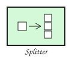</td><td><b>Splitter</b><br><code>splitter</code></td><td>One message with many items becomes one message per item.</td></tr>
<tr><td></td><td><b>Aggregator</b><br><code>aggregator</code></td><td>Reassemble parts, with an explicit completion rule (count, timeout, predicate).</td></tr>
<tr><td>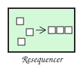</td><td><b>Resequencer</b><br><code>resequencer</code></td><td>Restore order by sequence number with a gap timeout.</td></tr>
<tr><td>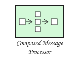</td><td><b>Composed Message Processor</b><br><code>composed-message-processor</code></td><td>Split, process the parts, aggregate the results.</td></tr>
<tr><td></td><td><b>Scatter-Gather</b><br><code>scatter-gather</code></td><td>Broadcast a request and gather replies with a timeout.</td></tr>
<tr><td>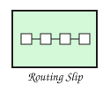</td><td><b>Routing Slip</b><br><code>routing-slip</code></td><td>Each message carries its own list of steps.</td></tr>
<tr><td>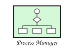</td><td><b>Process Manager</b><br><code>process-manager</code></td><td>The next step depends on intermediate results, state or timeouts.</td></tr>
<tr><td>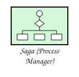</td><td><b>Saga (Process Manager)</b><br><code>saga</code></td><td>A long-running flow with compensation (same glyph as Process Manager).</td></tr>
</table>

### Transformation

<table>
<tr><th width="204">Stencil</th><th width="187">Kind</th><th>Use when</th></tr>
<tr><td>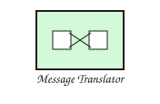</td><td><b>Message Translator</b><br><code>message-translator</code></td><td>Format or model changes between hops, typically at a bounded-context border.</td></tr>
<tr><td></td><td><b>Envelope Wrapper</b><br><code>envelope-wrapper</code></td><td>Transport metadata is added at the boundary and stripped at the other side.</td></tr>
<tr><td>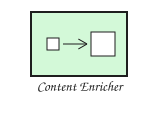</td><td><b>Content Enricher</b><br><code>content-enricher</code></td><td>The message needs data fetched from elsewhere.</td></tr>
<tr><td>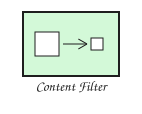</td><td><b>Content Filter</b><br><code>content-filter</code></td><td>Strip the payload to the fields the consumer needs.</td></tr>
<tr><td>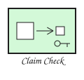</td><td><b>Claim Check</b><br><code>claim-check</code></td><td>Store the payload and send a reference.</td></tr>
<tr><td>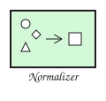</td><td><b>Normalizer</b><br><code>normalizer</code></td><td>Several input formats become one common format.</td></tr>
</table>

### Messaging endpoints

<table>
<tr><th width="220">Stencil</th><th width="212">Kind</th><th>Use when</th></tr>
<tr><td>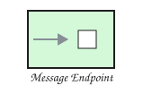</td><td><b>Message Endpoint</b><br><code>message-endpoint</code></td><td>A generic receive point; the endpoint style is not the point.</td></tr>
<tr><td></td><td><b>Messaging Gateway</b><br><code>messaging-gateway</code></td><td>Expose a domain interface over messaging (<code>orders.place(order)</code>).</td></tr>
<tr><td></td><td><b>Messaging Mapper</b><br><code>messaging-mapper</code></td><td>Map domain objects to and from messages.</td></tr>
<tr><td>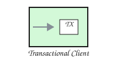</td><td><b>Transactional Client</b><br><code>transactional-client</code></td><td>Send or receive is tied to the local transaction.</td></tr>
<tr><td>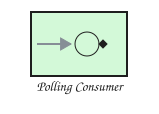</td><td><b>Polling Consumer</b><br><code>polling-consumer</code></td><td>The consumer pulls at its own pace (long polling, batches).</td></tr>
<tr><td></td><td><b>Event-Driven Consumer</b><br><code>event-driven-consumer</code></td><td>The broker pushes; bounded prefetch.</td></tr>
<tr><td>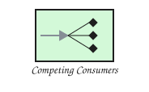</td><td><b>Competing Consumers</b><br><code>competing-consumers</code></td><td>Several instances share one point-to-point channel.</td></tr>
<tr><td>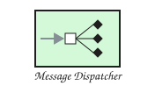</td><td><b>Message Dispatcher</b><br><code>message-dispatcher</code></td><td>One consumer hands messages to specific performers.</td></tr>
<tr><td></td><td><b>Selective Consumer</b><br><code>selective-consumer</code></td><td>The broker filters by selector before delivery.</td></tr>
<tr><td>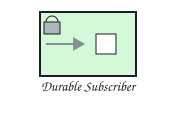</td><td><b>Durable Subscriber</b><br><code>durable-subscriber</code></td><td>No message gaps while the subscriber is down.</td></tr>
<tr><td></td><td><b>Idempotent Receiver</b><br><code>idempotent-receiver</code></td><td>The handler is safe under redelivery.</td></tr>
<tr><td></td><td><b>Service Activator</b><br><code>service-activator</code></td><td>A thin adapter invokes a plain service method.</td></tr>
<tr><td>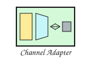</td><td><b>Channel Adapter</b><br><code>channel-adapter</code></td><td>Connect an application or protocol to the messaging system.</td></tr>
</table>

### System management

<table>
<tr><th width="178">Stencil</th><th width="162">Kind</th><th>Use when</th></tr>
<tr><td>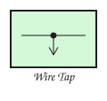</td><td><b>Wire Tap</b><br><code>wire-tap</code></td><td>Copy messages to a side channel for audit or debugging.</td></tr>
<tr><td></td><td><b>Detour</b><br><code>detour</code></td><td>Route through extra steps switched on at runtime.</td></tr>
<tr><td>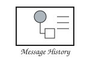</td><td><b>Message History</b><br><code>message-history</code></td><td>Record each hop on the message.</td></tr>
<tr><td></td><td><b>Smart Proxy</b><br><code>smart-proxy</code></td><td>Intercept requests and replies to measure them, then forward.</td></tr>
<tr><td>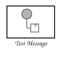</td><td><b>Test Message</b><br><code>test-message</code></td><td>Inject a probe periodically and verify it at the end of the flow.</td></tr>
<tr><td></td><td><b>Channel Purger</b><br><code>channel-purger</code></td><td>Clear leftover junk in test setup or recovery, scoped and logged.</td></tr>
</table>

### Messaging infrastructure

<table>
<tr><th width="220">Stencil</th><th width="171">Kind</th><th>Use when</th></tr>
<tr><td>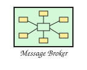</td><td><b>Message Broker</b><br><code>message-broker</code></td><td>The broker is a participant; keep it to hub routing, no business logic.</td></tr>
<tr><td>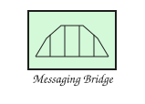</td><td><b>Messaging Bridge</b><br><code>messaging-bridge</code></td><td>Connect two brokers or broker clusters.</td></tr>
<tr><td></td><td><b>Transactional Outbox</b><br><code>outbox</code></td><td>Publish as part of the local transaction.</td></tr>
<tr><td></td><td><b>Transactional Inbox</b><br><code>inbox</code></td><td>Dedupe/consume as part of the local transaction.</td></tr>
</table>

### Participants and stores

<table>
<tr><th width="232">Stencil</th><th width="162">Kind</th><th>Use when</th></tr>
<tr><td>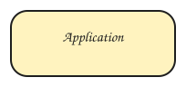</td><td><b>Application</b><br><code>service</code></td><td>A service or application you own.</td></tr>
<tr><td></td><td><b>External system</b><br><code>external-system</code> or <code>external</code></td><td>A system outside your control.</td></tr>
<tr><td></td><td><b>Actor</b><br><code>actor</code></td><td>A person or client.</td></tr>
<tr><td>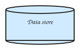</td><td><b>Data store</b><br><code>datastore</code> or <code>db</code></td><td>State the service owns.</td></tr>
<tr><td>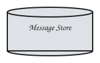</td><td><b>Message Store</b><br><code>message-store</code></td><td>Copies of messages for audit, replay or reconciliation.</td></tr>
<tr><td></td><td><b>Schema Registry</b><br><code>schema-registry</code></td><td>Where message schemas live.</td></tr>
<tr><td></td><td><b>Note</b><br><code>note</code></td><td>A sticky annotation; use <code>attach</code> to place it under a node.</td></tr>
</table>

### Badges

Pills on a `service` or `external-system` node, e.g. `"badges": ["idempotent", "competing:3"]`.

<table>
<tr><th width="244">Stencil</th><th width="162">Badge</th><th>Use when</th></tr>
<tr><td></td><td><b>Messaging Gateway</b><br><code>gateway</code></td><td>The service is reached through a messaging interface.</td></tr>
<tr><td>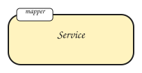</td><td><b>Messaging Mapper</b><br><code>mapper</code></td><td>The service maps domain objects to messages.</td></tr>
<tr><td></td><td><b>Service Activator</b><br><code>activator</code></td><td>The endpoint calls a plain service method.</td></tr>
<tr><td>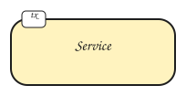</td><td><b>Transactional Client</b><br><code>tx</code></td><td>Send/receive is tied to the service's transaction.</td></tr>
<tr><td></td><td><b>Transactional Outbox</b><br><code>outbox</code></td><td>Publishes are written in the same transaction as the state change.</td></tr>
<tr><td></td><td><b>Transactional Inbox</b><br><code>inbox</code></td><td>Consumes are deduplicated in the same transaction.</td></tr>
<tr><td>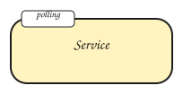</td><td><b>Polling Consumer</b><br><code>polling</code></td><td>The service pulls.</td></tr>
<tr><td>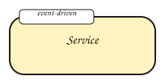</td><td><b>Event-Driven Consumer</b><br><code>event-driven</code></td><td>The broker pushes.</td></tr>
<tr><td></td><td><b>Competing Consumers</b><br><code>competing</code></td><td>Several instances consume the same channel; <code>competing:N</code> states the count.</td></tr>
<tr><td></td><td><b>Message Dispatcher</b><br><code>dispatcher</code></td><td>One consumer hands work to specific performers.</td></tr>
<tr><td>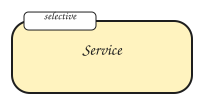</td><td><b>Selective Consumer</b><br><code>selective</code></td><td>The service receives only selected messages.</td></tr>
<tr><td></td><td><b>Durable Subscriber</b><br><code>durable</code></td><td>The subscription survives downtime.</td></tr>
<tr><td></td><td><b>Idempotent Receiver</b><br><code>idempotent</code></td><td>Redelivery is safe.</td></tr>
<tr><td></td><td><b>Channel Adapter</b><br><code>adapter</code></td><td>A protocol or legacy system is adapted to messaging.</td></tr>
<tr><td>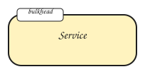</td><td><b>Bulkhead</b><br><code>bulkhead</code></td><td>Failures are isolated per pool.</td></tr>
<tr><td></td><td><b>Retry</b><br><code>retry</code></td><td>Bounded retries before the DLQ.</td></tr>
<tr><td></td><td><b>Circuit Breaker</b><br><code>circuit-breaker</code></td><td>The caller stops calling a failing dependency.</td></tr>
</table>

### Arrows

<table>
<tr><th width="404">Stencil</th><th width="187">Edge</th><th>Means</th></tr>
<tr><td>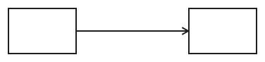</td><td><b>Message</b><br><code>"kind": "message"</code> (the default)</td><td>A message on a channel.</td></tr>
<tr><td></td><td><b>Command Message</b><br><code>"type": "command"</code></td><td>A command.</td></tr>
<tr><td>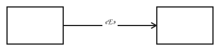</td><td><b>Event Message</b><br><code>"type": "event"</code></td><td>An event.</td></tr>
<tr><td></td><td><b>Document Message</b><br><code>"type": "document"</code></td><td>A document.</td></tr>
<tr><td>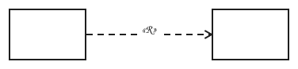</td><td><b>Reply (Request-Reply)</b><br><code>"type": "reply"</code></td><td>A reply.</td></tr>
<tr><td></td><td><b>Synchronous call (RPC)</b><br><code>"kind": "rpc"</code></td><td>A synchronous call — the exception.</td></tr>
<tr><td></td><td><b>Data access</b><br><code>"kind": "data"</code></td><td>A direct data access.</td></tr>
<tr><td></td><td><b>Wire Tap copy</b><br><code>"kind": "tap"</code></td><td>A copy is taken without disturbing the flow.</td></tr>
<tr><td></td><td><b>Dead letter route</b><br><code>"kind": "dlq"</code></td><td>A failed message is routed to a dead letter channel.</td></tr>
<tr><td></td><td><b>Control Bus command</b><br><code>"kind": "control"</code></td><td>A management command.</td></tr>
</table>
<!-- stencils:end -->

## Develop

```sh
node --test
claude plugin validate .
# the Agent Skills reference validator is a Python tool; CI runs it the same way (needs uv)
uvx --from skills-ref agentskills validate skills/excalidraw-architecture

# rebuild the README diagram after changing its spec or the generator
node skills/excalidraw-architecture/scripts/eip_excalidraw.mjs build docs/fan-out.spec.json --no-svg --strict --png

# regenerate docs/stencils/ and the README's stencil tables after changing the generator or the
# kind, badge and edge tables in references/spec.md and references/notation.md
node tools/stencils.mjs
```

## License

MIT
